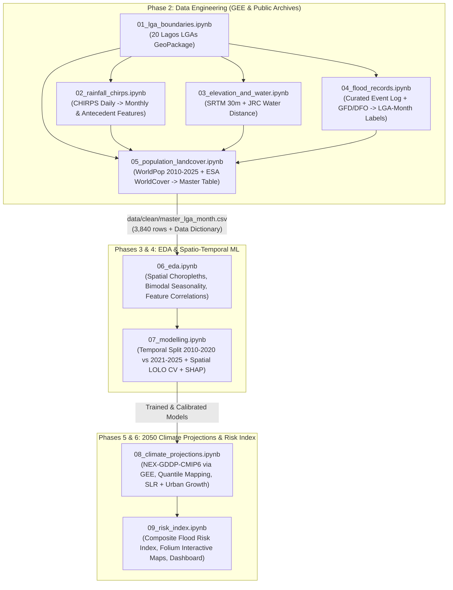

# Lagos Flood Risk ML — Senior ML Engineering Audit & Execution Plan

## 1. Executive Summary & Current State Audit

I have reviewed the project documentation (`Project Brief` and `Complete Work Plan`), datasets (`data/raw/` and `data/clean/`), and all 9 notebooks in [`notebooks/`](file:///c:/Users/LENOVO/Desktop/Portfolio%20Projects/lagos-flood-risk-ml/notebooks).

### What Is Already Built (Notebooks 01–04)
 The foundation laid in the first four notebooks is clean, modular, and reproducible:
- **[01_lga_boundaries.ipynb](file:///c:/Users/LENOVO/Desktop/Portfolio%20Projects/lagos-flood-risk-ml/notebooks/01_lga_boundaries.ipynb)** *(Complete)*: Extracts the 20 Lagos State LGAs from GADM (`ADM_ADM_2`) and saves [`lagos_lgas.gpkg`](file:///c:/Users/LENOVO/Desktop/Portfolio%20Projects/lagos-flood-risk-ml/data/clean/lagos_lgas.gpkg).
- **[02_rainfall_chirps.ipynb](file:///c:/Users/LENOVO/Desktop/Portfolio%20Projects/lagos-flood-risk-ml/notebooks/02_rainfall_chirps.ipynb)** *(Complete)*: Connects to Google Earth Engine (`UCSB-CHG/CHIRPS/DAILY`), extracts 116,880 daily LGA records (2010–2025) across 32 six-month chunks into [`chirps_daily_lga.csv`](file:///c:/Users/LENOVO/Desktop/Portfolio%20Projects/lagos-flood-risk-ml/data/raw/chirps_daily_lga.csv), and aggregates 6 monthly rainfall features into [`rainfall_lga_month.csv`](file:///c:/Users/LENOVO/Desktop/Portfolio%20Projects/lagos-flood-risk-ml/data/clean/rainfall_lga_month.csv) (3,840 rows).
- **[03_elevation_and_water.ipynb](file:///c:/Users/LENOVO/Desktop/Portfolio%20Projects/lagos-flood-risk-ml/notebooks/03_elevation_and_water.ipynb)** *(Complete)*: Uses SRTM (30m) and JRC Global Surface Water (30m) via GEE to compute land-masked elevation statistics (`elev_mean_m`, `elev_median_m`, `low5_share`, `low10_share`, `slope_mean_deg`), permanent water share, and Euclidean distance to water (`dist_water_mean_km`, `near_water_1km_share`) into [`terrain_water_lga.csv`](file:///c:/Users/LENOVO/Desktop/Portfolio%20Projects/lagos-flood-risk-ml/data/clean/terrain_water_lga.csv) (20 rows).
- **[04_flood_records.ipynb](file:///c:/Users/LENOVO/Desktop/Portfolio%20Projects/lagos-flood-risk-ml/notebooks/04_flood_records.ipynb)** *(Pipeline Built, Data Unpopulated)*: Queries the Dartmouth Flood Observatory (DFO) ArcGIS mirror, parses [`flood_events_log.csv`](file:///c:/Users/LENOVO/Desktop/Portfolio%20Projects/lagos-flood-risk-ml/data/raw/flood_events/flood_events_log.csv) with a neighbourhood-to-LGA regex mapper (`PLACE_TO_LGA`), and builds [`flood_labels_lga_month.csv`](file:///c:/Users/LENOVO/Desktop/Portfolio%20Projects/lagos-flood-risk-ml/data/clean/flood_labels_lga_month.csv) (3,840 rows) and [`flood_labels_state_month.csv`](file:///c:/Users/LENOVO/Desktop/Portfolio%20Projects/lagos-flood-risk-ml/data/clean/flood_labels_state_month.csv) (192 rows).

### What Is Empty / Pending (Notebooks 05–09)
- **[05_population_landcover.ipynb](file:///c:/Users/LENOVO/Desktop/Portfolio%20Projects/lagos-flood-risk-ml/notebooks/05_population_landcover.ipynb)** *(Empty — 0 cells)*
- **[06_eda.ipynb](file:///c:/Users/LENOVO/Desktop/Portfolio%20Projects/lagos-flood-risk-ml/notebooks/06_eda.ipynb)** *(Empty — 0 cells)*
- **[07_modelling.ipynb](file:///c:/Users/LENOVO/Desktop/Portfolio%20Projects/lagos-flood-risk-ml/notebooks/07_modelling.ipynb)** *(Empty — 0 cells)*
- **[08_climate_projections.ipynb](file:///c:/Users/LENOVO/Desktop/Portfolio%20Projects/lagos-flood-risk-ml/notebooks/08_climate_projections.ipynb)** *(Empty — 0 cells)*
- **[09_risk_index.ipynb](file:///c:/Users/LENOVO/Desktop/Portfolio%20Projects/lagos-flood-risk-ml/notebooks/09_risk_index.ipynb)** *(Empty — 0 cells)*
- **Outputs & Dashboard**: `outputs/` is currently empty; `README.md` is a 2-line stub; no `requirements.txt` exists yet.

---

## 2. Critical Technical Bottlenecks & How We Will Improve Existing Work

> [!IMPORTANT]
> **Critical Blocker #1: Zero Positive LGA-Month Labels in `flood_labels_lga_month.csv`**
> Right now, [`flood_events_log.csv`](file:///c:/Users/LENOVO/Desktop/Portfolio%20Projects/lagos-flood-risk-ml/data/raw/flood_events/flood_events_log.csv) has **0 rows**, and the only DFO event in Lagos (`DFO-4649`, July 2018) touched 19 LGAs (`> DFO_MAX_LGAS = 10`), so it was flagged as `regional = True` and excluded from the LGA-level labels. Consequently, `flood_labels_lga_month.csv` has **0 positive labels out of 3,840 rows (0.0%)**. No supervised model can be trained until we populate historical flood records and/or integrate satellite-observed flood extents.

### High-Impact Improvements to Notebooks 02, 03, and 04

1. **Automated Multi-Source Flood Event Harvesting ([04_flood_records.ipynb](file:///c:/Users/LENOVO/Desktop/Portfolio%20Projects/lagos-flood-risk-ml/notebooks/04_flood_records.ipynb))**:
   - **GEE Global Flood Database (`GLOBAL_FLOOD_DB/MODIS_EVENTS/V1`) & Sentinel-1 SAR Water Extents**: We already have active Google Earth Engine access in Notebooks 02 and 03! We can query the **Global Flood Database** directly in GEE and compute actual flooded pixel fractions per LGA per event (instead of throwing away DFO polygons just because their coarse bounding polygon overlaps >10 LGAs).
   - **GDELT / ReliefWeb / Literature & Curated Historical Lagos Flood Log**: We can programmatically compile documented historical Lagos flood events (2010–2025) from published literature (e.g., NIHSA Annual Flood Outlooks, NEMA/LASEMA situation reports, major Lagos floods such as July 2011, June 2012, July 2017, July 2018, June–July 2020, July 2021, July/Oct 2022, July 2023, June–July 2024) with verified dates, sources, and affected LGAs into [`flood_events_log.csv`](file:///c:/Users/LENOVO/Desktop/Portfolio%20Projects/lagos-flood-risk-ml/data/raw/flood_events/flood_events_log.csv), plus expand `PLACE_TO_LGA` to cover 150+ Lagos neighbourhoods and LCDAs.
   - **Positive-Unlabelled (PU) & Sample Weighting Awareness**: Since `label = 0` means *"unreported"* rather than *"guaranteed dry"*, we can assign confidence weights or test sensitivity across severity thresholds.

2. **Hydrological & Antecedent Rainfall Features ([02_rainfall_chirps.ipynb](file:///c:/Users/LENOVO/Desktop/Portfolio%20Projects/lagos-flood-risk-ml/notebooks/02_rainfall_chirps.ipynb))**:
   - **Antecedent Soil Moisture Proxy (`rain_prev_month_mm`, `rain_2m_cum_mm`)**: In Lagos, flooding in June/July or September/October is heavily driven by water-table saturation from the preceding month's rain. Adding lagged 1-month rainfall and anomaly features (`rain_zscore_lga` and `rain_pct_of_annual`) from the existing `chirps_daily_lga.csv` requires zero extra GEE downloads and significantly boosts predictive skill.
   - **Cyclical Seasonality Encoding**: Add `month_sin` and `month_cos` ($\sin(2\pi m/12), \cos(2\pi m/12)$) so linear and tree models capture the bimodal Lagos rainy season (May–July peak, August "little dry season" dip, September–October secondary peak) smoothly.

3. ** Climate-Compatible Feature Subset Alignment ([02_rainfall_chirps.ipynb](file:///c:/Users/LENOVO/Desktop/Portfolio%20Projects/lagos-flood-risk-ml/notebooks/02_rainfall_chirps.ipynb) & [07_modelling.ipynb](file:///c:/Users/LENOVO/Desktop/Portfolio%20Projects/lagos-flood-risk-ml/notebooks/07_modelling.ipynb))**:
   - As noted in your Project Brief, CMIP6/CORDEX projections are most reliable for monthly totals (`rain_total_mm`, `rain_prev_month_mm`) and daily extremes (`rx1day` / `rx5day` if daily CMIP6 is pulled from GEE `NASA/GDDP-CMIP6`). Because `NASA/GDDP-CMIP6` is available on Google Earth Engine at **daily** resolution (0.25°, bias-corrected NEX-GDDP-CMIP6 for SSP2-4.5 and SSP5-8.5!), we can actually compute the **exact same 6 daily-to-monthly rainfall features** (`rain_total_mm`, `rain_max_daily_mm`, `rain_max_3day_mm`, `rain_max_7day_mm`, `rainy_days`, `heavy_rain_days`) for 2030–2050 across an ensemble of climate models in GEE!

---

## 3. End-to-End Architecture & Notebook Roadmap

### Detailed Plan for Remaining Notebooks (05 to 09)

#### Step 1: Curate & Upgrade `04_flood_records.ipynb` + Enhance `02_rainfall_chirps.ipynb`
- Populate [`data/raw/flood_events/flood_events_log.csv`](file:///c:/Users/LENOVO/Desktop/Portfolio%20Projects/lagos-flood-risk-ml/data/raw/flood_events/flood_events_log.csv) with a thoroughly researched, citation-backed table of documented Lagos flood events (2010–2025) across all 20 LGAs from NEMA, NIHSA, LASEMA, EM-DAT, and major Nigerian news archives, plus check GEE's `GLOBAL_FLOOD_DB/MODIS_EVENTS/V1` for satellite-detected inundation in Lagos.
- Add antecedent rainfall (`rain_prev_month_mm`, `rain_2m_total_mm`) and LGA rainfall anomaly features in `02_rainfall_chirps.ipynb`.
- Verify that [`flood_labels_lga_month.csv`](file:///c:/Users/LENOVO/Desktop/Portfolio%20Projects/lagos-flood-risk-ml/data/clean/flood_labels_lga_month.csv) achieves a realistic positive event count ($\ge 150$ positive LGA-months across 2010–2025) and passes all quality assertions.

#### Step 2: Build & Run `05_population_landcover.ipynb` + Master Dataset Assembly
- **Land Cover via GEE (`ESA/WorldCover/v100` & `v200`, 10m resolution)**:
  - Compute land-area shares for each LGA: `built_share` (class 50: impervious/urban surfaces that prevent infiltration), `wetland_mangrove_share` (classes 90 & 95: natural flood buffers/swamps), `tree_crop_grass_share` (classes 10–40: permeable ground), and `bare_share` (class 60).
- **Population & Exposure via GEE (`WorldPop/GP/100m/pop`)**:
  - Extract annual population counts per LGA (2010–2020 observed in WorldPop) and project/extrapolate smoothly through 2025 using Lagos/UN urban growth rates (~3.2–3.5%/yr), computing `pop_total`, `land_area_km2`, and `pop_density_km2`.
- **Master Table & Data Dictionary**:
  - Merge `flood_labels_lga_month.csv`, `rainfall_lga_month.csv`, `terrain_water_lga.csv`, and `population_landcover_lga.csv` into **`data/clean/master_lga_month.csv`** (3,840 rows, zero unexpected nulls).
  - Auto-generate `data/clean/data_dictionary.csv` and markdown documentation listing every column, unit, physical interpretation, and data source.

#### Step 3: Build & Run `06_eda.ipynb` (Exploratory Data Analysis & Feature Selection)
- **Narrative-Driven Analysis**: Following ML best practices, every code cell will be paired with a clear markdown interpretation telling the story of flooding in Lagos.
- **Visualizations** (saved to `outputs/figures/`):
  1. Spatial choropleth of historical flood frequency across the 20 LGAs alongside elevation (`low5_share`) and impervious surface (`built_share`).
  2. Seasonal profile: Bimodal rainfall vs. monthly flood probability (highlighting why June–July and September–October dominate, and how antecedent rainfall triggers late-season floods).
  3. Distribution comparison (boxplots/violin plots) of `rain_total_mm`, `rain_max_daily_mm`, `rain_max_3day_mm`, and `elev_mean_m` on `flood == 1` vs. `flood == 0` months, with non-parametric Mann-Whitney U statistical tests.
  4. Spearman/Pearson correlation heatmap and Variance Inflation Factor (VIF) check to identify collinear features before modelling.

#### Step 4: Build & Run `07_modelling.ipynb` (Supervised ML, Validation & Explainability)
- **Strict Featurization & Leakage Prevention**:
  - **Temporal Split**: Train on `2010–2020` (2,640 rows), Test on `2021–2025` (1,200 rows). Fit all `StandardScaler` / preprocessing pipelines **strictly on the training split**.
  - **Time-Aware Cross-Validation (`TimeSeriesSplit` / Expanding Window by Year)** for hyperparameter tuning on the 2010–2020 training set.
  - **Spatial Hold-Out Validation (`LeaveOneGroupOut` / Grouped Spatial CV by LGA)** to measure how well the model generalises to an unseen LGA based solely on its terrain, land cover, and rainfall.
- **Model Suite & Class Imbalance Handling**:
  1. **Naive & Rule Baselines**: Climatological monthly baseline & simple rainfall threshold baseline.
  2. **Logistic Regression**: With `StandardScaler`, `class_weight="balanced"`, and $L_2$ regularisation.
  3. **Random Forest Classifier**: With `class_weight="balanced_subsample"` and depth/leaf regularisation to prevent memorising LGA identities.
  4. **Gradient Boosting (XGBoost / LightGBM)**: With `scale_pos_weight` and monotonic constraints option (e.g., higher rainfall and lower elevation cannot *decrease* flood probability — a great domain-informed ML improvement!).
- **Evaluation, Threshold Tuning & Explainability**:
  - Report **PR-AUC (Average Precision)**, **ROC-AUC**, **F1-Score**, **Recall**, **Precision**, **Brier Score** (calibration), with **95% bootstrap confidence intervals**.
  - Plot Precision–Recall curves, ROC curves, Calibration curves, and Confusion Matrices at an intentionally selected early-warning operating threshold (optimising $F_2$-score or F1 to prioritise catching real floods without excessive false alarms).
  - Slice-based error analysis: Evaluate errors across Coastal/Lagoon vs. Inland LGAs, and across peak vs. shoulder rainy months.
  - **SHAP (SHapley Additive exPlanations)** & Permutation Importance to show what drives predictions globally and for specific LGAs (e.g., Eti-Osa vs. Alimosho).
  - Save the best model pipeline and feature list to `outputs/models/`.

#### Step 5: Build & Run `08_climate_projections.ipynb` (CMIP6 2030–2050 Projections)
- **Multi-Model Ensemble via GEE (`NASA/GDDP-CMIP6`)**:
  - Extract daily precipitation (`pr`) for Lagos across 3–5 CMIP6 Global Climate Models (e.g., `ACCESS-CM2`, `GFDL-ESM4`, `MPI-ESM1-2-HR`, `MRI-ESM2-0`, `UKESM1-0-LL`) for **historical reference (2010–2014)** and **future scenarios (`SSP2-4.5` and `SSP5-8.5`, 2030–2050)**.
- **Bias Correction (Quantile Delta Mapping / Linear Scaling)**:
  - Bias-correct each GCM's Lagos rainfall distribution against our observed CHIRPS baseline so model biases in drizzle days or extreme tails are removed.
- **Future Drivers (Sea-Level Rise & Urban Growth)**:
  - Incorporate IPCC AR6 regional sea-level rise projections for Lagos coast (~0.15m by 2030, ~0.25m by 2040, ~0.35–0.45m by 2050 under SSP2-4.5 / SSP5-8.5), adjusting effective low-lying exposure for coastal/lagoon LGAs.
  - Incorporate SSP-consistent population and built-up surface projections to 2050.
- **Ensemble Risk Projections**:
  - Predict monthly flood probabilities for **2030–2039**, **2040–2049**, and **2050**, reporting the **multi-model mean and min–max / interquartile range** across GCMs.

#### Step 6: Build & Run `09_risk_index.ipynb` + Interactive Maps & Dashboard
- **IPCC Risk Framework Composite Index**:
  $$\text{Flood Risk Index (FRI)} = w_H \cdot \text{Hazard} + w_V \cdot \text{Vulnerability} + w_E \cdot \text{Exposure}$$
  - **Hazard ($H$)**: Model-predicted annual/wet-season flood probability (including SLR coastal modifier).
  - **Vulnerability ($V$)**: Normalized composite of `low5_share`, `near_water_1km_share`, `built_share` (imperviousness), and inverse slope.
  - **Exposure ($E$)**: Normalized `pop_density_km2` and total population in flood-prone zones.
  - Include sensitivity analysis showing LGA rankings are robust to weight choices ($w_H, w_V, w_E$).
- **Deliverables**:
  - Interactive **Folium** HTML maps saved to `outputs/maps/` (comparing Baseline vs. 2030, 2040, 2050 under SSP2-4.5 and SSP5-8.5).
  - A self-contained **Streamlit Dashboard (`app.py`)** where a user or supervisor can select an LGA, scenario (SSP2-4.5 / SSP5-8.5), and decade (Baseline, 2030s, 2040s, 2050) to inspect flood probability, exposed population, seasonal curves, and planning recommendations.
  - Updated `README.md` and `requirements.txt`.

---

## 4. Proposed Execution Order

1. **Milestone 1 (Data Completion — Notebooks 02, 04, 05)**: Populate the historical Lagos flood event log & satellite flood records, add antecedent rainfall features, extract WorldPop + ESA WorldCover via GEE, and build `data/clean/master_lga_month.csv` + `data_dictionary.csv`.
2. **Milestone 2 (EDA & Modelling — Notebooks 06, 07)**: Execute exploratory analysis, statistical tests, temporal + spatial cross-validation, model comparison (Logistic Regression, Random Forest, XGBoost/LightGBM), threshold calibration, and SHAP explainability.
3. **Milestone 3 (Climate Projections & Risk Index — Notebooks 08, 09 + Dashboard)**: Extract & bias-correct CMIP6 projections via GEE for SSP2-4.5 and SSP5-8.5 (2030–2050), compute the Flood Risk Index and exposed population, and generate interactive Folium maps + Streamlit dashboard.
